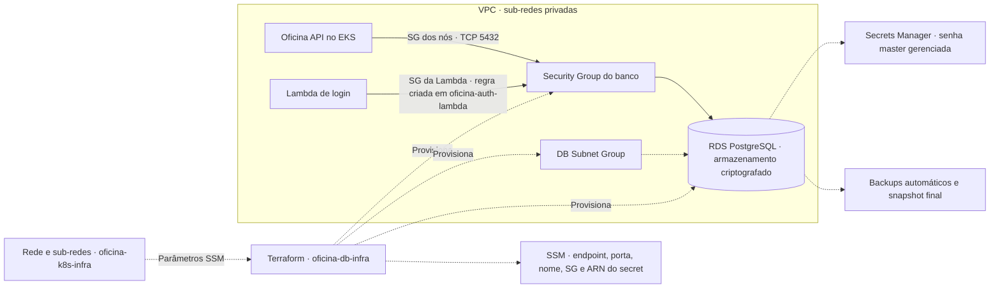

# Oficina — Banco de dados

Terraform do RDS PostgreSQL privado, rede do banco, backups, criptografia e credencial gerenciada no Secrets Manager. Depende da rede publicada por oficina-k8s-infra. As tabelas são criadas pelo Flyway da API, não por este Terraform.

## Responsabilidades deste repositório

- consumir a rede privada e o Security Group dos nós EKS publicados pela plataforma;
- provisionar subnet group, Security Group e RDS PostgreSQL privado;
- habilitar armazenamento criptografado, backups e crescimento automático do armazenamento;
- manter proteção contra exclusão e snapshot final para remoção intencional;
- delegar a geração e manutenção da senha master ao Secrets Manager;
- publicar endpoint, porta, nome do banco, Security Group e ARN da credencial no SSM.

## Índice da documentação

| Assunto | Documento |
| --- | --- |
| Validação e execução pelo terminal | [Validação local e execução manual](docs/VALIDACAO-E-EXECUCAO-MANUAL.md) |
| Checklist GitHub, dependências, deploy e encerramento | [Execução na AWS](docs/EXECUCAO-AWS.md) |
| Tecnologias, ferramentas, versões e fontes | [Tecnologias e versões](docs/VERSOES.md) |
| Diagnóstico por assunto e recuperação | [Troubleshooting](docs/TROUBLESHOOTING.md) |

## Repositórios da solução

| Repositório | Responsabilidade |
| --- | --- |
| [gestao-oficina-tc-1](https://github.com/tc-organization-26/gestao-oficina-tc-1#readme) | API Java, migrations, Docker Compose e deploy da aplicação |
| [oficina-k8s-infra](https://github.com/tc-organization-26/oficina-k8s-infra#readme) | Bootstrap, rede, EKS, escalabilidade e entrada HTTP |
| [oficina-db-infra](https://github.com/tc-organization-26/oficina-db-infra#readme) | RDS PostgreSQL privado, backups e credencial gerenciada |
| [oficina-auth-lambda](https://github.com/tc-organization-26/oficina-auth-lambda#readme) | Login por CPF, JWT e rotas protegidas do Gateway |

## Dependência obrigatória

Execute primeiro `oficina-k8s-infra`. Este Terraform lê os seguintes parâmetros do AWS Systems Manager Parameter Store:

```text
/oficina/ENV/network/vpc-id
/oficina/ENV/network/private-subnet-ids
/oficina/ENV/eks/node-security-group-id
```

Se esses parâmetros não existirem para o ambiente selecionado, o `terraform plan` falhará antes de criar o banco.

## Execução e deploy

### Validação local e execução manual

Consulte o [guia de validação local e execução manual](docs/VALIDACAO-E-EXECUCAO-MANUAL.md) para validar o Terraform e executar plan/apply pelo terminal com o backend correto. A validação não exige credenciais AWS, mas o init pode baixar providers.

Este repositório não cria PostgreSQL local. Para desenvolvimento, use o Compose da aplicação. Executar Terraform no computador continua provisionando RDS na AWS.

### Deploy e execução na AWS

Prepare o [checklist de acessos e configurações](docs/EXECUCAO-AWS.md#checklist-inicial) e conclua as dependências na [ordem de implantação](docs/EXECUCAO-AWS.md#ordem-da-primeira-implantação). Faça o merge para `homologacao` para disparar o deploy em `hom` e aguarde a conclusão. Para produção, use `main` após validar homologação. **Run workflow é uma alternativa ou reexecução**, não um passo obrigatório após o merge.

> O código contém adaptações educacionais de IAM e credenciais. Confira a observação do guia AWS antes de utilizá-lo em outra conta.

Conclua primeiro bootstrap e plataforma Kubernetes/rede no mesmo ambiente. O workflow valida, planeja e aplica o banco, sem executar SQL de negócio. Autenticação e API usam os dados publicados no SSM; a API cria as tabelas quando o Flyway inicia.

## Arquitetura



Consulte os [recursos principais](#recursos-principais) deste componente. A [arquitetura integrada da aplicação](https://github.com/tc-organization-26/gestao-oficina-tc-1/blob/HEAD/docs/ARQUITETURA-SOLUCAO.md) reúne os quatro projetos e suas sequências.

## Arquitetura provisionada

A API no EKS e a Lambda de login acessam o mesmo RDS privado por regras de Security Group distintas. O Secrets Manager mantém a credencial gerenciada. A API executa o Flyway; a Lambda consulta `cliente` para autenticação. A [visão de componentes](https://github.com/tc-organization-26/gestao-oficina-tc-1/blob/HEAD/docs/ARQUITETURA-SOLUCAO.md#diagrama-de-componentes-da-aplicação) mostra essas conexões.

O banco é um serviço gerenciado RDS; não utiliza contêiner, Dockerfile ou PVC Kubernetes.

## Recursos principais

| Recurso | Finalidade |
| --- | --- |
| `aws_db_subnet_group` | Posiciona o RDS nas sub-redes privadas |
| `aws_security_group` | Isola a comunicação com o PostgreSQL |
| `aws_vpc_security_group_ingress_rule` | Libera `5432/TCP` apenas para o Security Group do EKS |
| `aws_db_instance` | Instância PostgreSQL gerenciada |
| `aws_ssm_parameter` | Publica dados não secretos para os consumidores |

Principais características da instância:

- engine PostgreSQL 16 por padrão;
- armazenamento `gp3` criptografado;
- 20 GiB iniciais e autoscaling até 100 GiB por padrão;
- endpoint privado;
- `multi_az=false` por padrão; sub-redes em duas zonas não habilitam automaticamente uma instância standby;
- senha master gerenciada automaticamente;
- retenção de backup de sete dias;
- snapshot final obrigatório na destruição;
- proteção contra exclusão habilitada por padrão.

## Acesso à API

Este repositório provisiona infraestrutura e não expõe uma API de negócio própria. A documentação e as requisições da aplicação consumidora estão disponíveis em:

- [Swagger local da Oficina API](http://localhost:8081/swagger-ui/index.html), após iniciar a aplicação.
- [Collection Insomnia da Oficina API](https://github.com/tc-organization-26/gestao-oficina-tc-1/blob/HEAD/src/main/docs/insomnia/collection.yaml).
- [Collection Insomnia do login por CPF](https://github.com/tc-organization-26/oficina-auth-lambda/blob/HEAD/docs/insomnia/collection.json).

## Estrutura do repositório

| Arquivo ou diretório | Responsabilidade |
| --- | --- |
| [main.tf](main.tf) | Rede via SSM, subnet group, SG, instância e publicação dos dados do banco |
| [variables.tf](variables.tf) | Região, ambiente, engine, classe, armazenamento, disponibilidade, backup e proteção |
| [outputs.tf](outputs.tf) | Endpoint, porta, nome e ARN sensível da credencial |
| [versions.tf](versions.tf) e [.terraform.lock.hcl](.terraform.lock.hcl) | Compatibilidade Terraform e resolução do provider AWS |
| [terraform.tfvars.example](terraform.tfvars.example) | Exemplo inicial para execução pelo terminal |
| [.github/workflows/terraform.yml](.github/workflows/terraform.yml) | Validação, plan/apply e promoção |
| [docs/](docs) | Execução, versões e diagnóstico |

## Variáveis Terraform

| Variável | Padrão | Descrição |
| --- | --- | --- |
| `aws_region` | `us-east-1` | Região AWS |
| `project_name` | `oficina` | Prefixo dos recursos e parâmetros |
| `environment` | `dev` | Ambiente usado nos nomes e caminhos SSM |
| `database_name` | `oficina_db` | Nome lógico do banco |
| `master_username` | `oficina_admin` | Usuário administrador |
| `engine_version` | `16` | Versão principal do PostgreSQL |
| `instance_class` | `db.t3.micro` | Classe da instância |
| `allocated_storage` | `20` | Armazenamento inicial em GiB |
| `max_allocated_storage` | `100` | Limite do autoscaling de armazenamento |
| `multi_az` | `false` | Habilita standby em outra AZ |
| `backup_retention_period` | `7` | Retenção de backups em dias |
| `deletion_protection` | `true` | Impede exclusão acidental |

O arquivo `terraform.tfvars.example` mostra uma configuração inicial; ajuste os valores ao ambiente desejado.

Exemplo com maior disponibilidade:

```hcl
aws_region              = "us-east-1"
project_name            = "oficina"
environment             = "prod"
instance_class          = "db.t3.small"
multi_az                = true
backup_retention_period = 14
deletion_protection     = true
```

## Outputs

| Output | Conteúdo |
| --- | --- |
| `database_endpoint` | DNS privado da instância |
| `database_port` | Porta do PostgreSQL |
| `database_name` | Nome lógico do banco |
| `master_secret_arn` | ARN sensível da credencial gerenciada |

## Parâmetros publicados no SSM

Após o apply são disponibilizados:

```text
/oficina/ENV/database/endpoint
/oficina/ENV/database/port
/oficina/ENV/database/name
/oficina/ENV/database/security-group-id
/oficina/ENV/database/master-secret-arn
```

O workflow da aplicação usa esses parâmetros para montar a URL JDBC e localizar o secret com `username` e `password`.

## Backend remoto

O state fica no bucket criado pelo bootstrap do repositório `oficina-k8s-infra`.

| Ambiente | Chave do state |
| --- | --- |
| Homologação | `oficina/database/hom.tfstate` |
| Produção | `oficina/database/prod.tfstate` |

O backend usa criptografia e locking nativo por `.tflock`.

## Migrations e inicialização

O Terraform não executa migrations. Quando a aplicação inicia, o Flyway lê os scripts do repositório `gestao-oficina-tc-1` e aplica as versões pendentes no RDS.

As [variáveis e migrations da API](https://github.com/tc-organization-26/gestao-oficina-tc-1/blob/HEAD/README.md#banco-e-migrations) documentam a configuração do Flyway. O primeiro startup precisa terminar antes de usar o login por CPF.

## Validação após o deploy

Confirme a instância em `available` e os parâmetros do ambiente no SSM, conforme o [roteiro de validação](docs/EXECUCAO-AWS.md#validar-o-banco). Os outputs são `database_endpoint`, `database_port`, `database_name` e `master_secret_arn`.

Teste a conexão a partir de um workload autorizado na VPC/EKS. Depois do startup da API, o readiness verifica também o banco. Uma instância disponível ainda pode estar sem tabelas se o Flyway não tiver concluído.

## Observabilidade

Eventos e métricas RDS ajudam a investigar disponibilidade, conexões, CPU e armazenamento. API e Lambda registram falhas PostgreSQL nos próprios logs/traces; a configuração Datadog pertence à aplicação. Consulte o [diagnóstico de conectividade e credenciais](docs/TROUBLESHOOTING.md#conectividade-e-credencial-gerenciada) e o [guia de observabilidade da API](https://github.com/tc-organization-26/gestao-oficina-tc-1/blob/HEAD/docs/OBSERVABILIDADE.md).

## Encerramento

`deletion_protection=true` impede a remoção da instância e `skip_final_snapshot=false` exige snapshot final. O identificador é `oficina-ENV-postgres-final`; um snapshot existente com o mesmo nome precisa ser tratado antes de outra destruição.

O [procedimento de encerramento](docs/EXECUCAO-AWS.md#encerramento) reúne a ordem de remoção, a desativação intencional da proteção e a conferência dos backups.

Remova autenticação e consumidores antes do RDS, e o banco antes da VPC. Snapshots preservados podem permanecer após a instância.

## Workflow

- [Workflow deste componente](.github/workflows/terraform.yml).
- [Histórico de execuções](https://github.com/tc-organization-26/oficina-db-infra/actions/workflows/terraform.yml).

### Fluxo de branches

`fase-3` valida e abre PR para `homologacao`; `homologacao` faz deploy em `hom` e abre PR para `main`; `main` faz deploy em `prod`. Os merges são manuais. Executar manualmente em `fase-3` também só valida. Consulte [branches e ambientes](docs/EXECUCAO-AWS.md#branches-e-ambientes).

## Troubleshooting

Consulte o [guia de diagnóstico deste componente](docs/TROUBLESHOOTING.md) para sintomas, comandos de verificação e correções por assunto. O guia também referencia os demais componentes quando a falha atravessa rede, banco, autenticação ou aplicação.